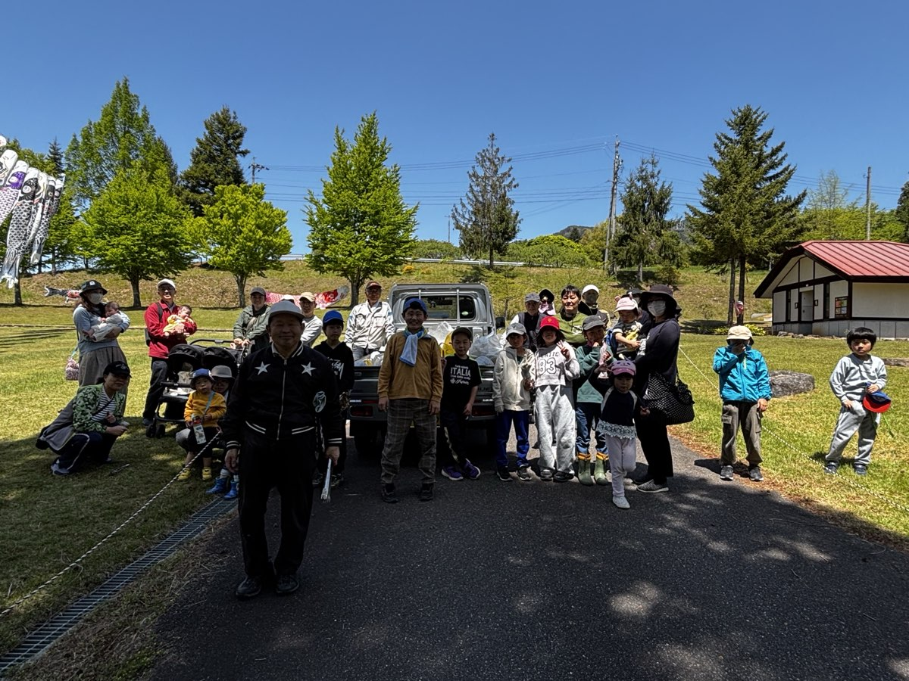
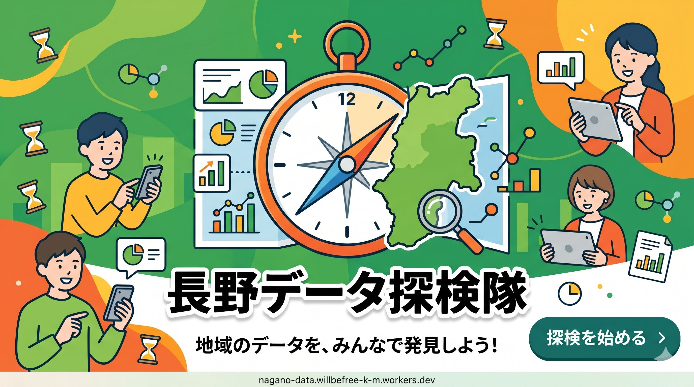

# 変更ログ

## 2026-11-10 — 活動実績の追加（アロマスプレーづくり・田植え・資産運用セミナー）

### 概要

じかんぎんこうで参加者を募った3つの活動を、活動実績に追加。

- 2026.03.24 アロマスプレーづくり（講師：坂野さん）
- 2026.05.17 わくわくの村の田んぼで田植え（田植え後の昼食でにら煎餅づくり）
- 2026.05.19 資産運用セミナー（講師：山本さん）

### 変更内容

- **`activities/2026-03-24-aroma-spray/index.html`**、**`activities/2026-05-17-rice-planting/index.html`**、**`activities/2026-05-19-asset-management-seminar/index.html`** — 個別詳細ページを生成し、本文と写真の説明（alt）を記載。
- **`activities/index.html`** — 一覧ページへ活動実績カードを3件挿入し、全カードを日付の新しい順に並べ替え。
- **`static/images/activities/<slug>/`** — リサイズ・圧縮した画像を配置（田植えの1枚目はスクリーンショットの左右の黒帯を切り取り、JPEGに変換）。元画像のフォルダは削除。

---

## 2026-11-10 — 活動実績の追加（世界の15の取り組みにえらばれました）

### 概要

イベロアメリカ時間銀行協会（ASIBDT）の「2026年 時間銀行のよい取り組み 世界レポート（第6回）」で、世界の15の取り組みのひとつに選ばれたことをお知らせ。
トップページに「お知らせ」セクションを新設し、活動実績にも記事を追加した。

### 変更内容

- **`index.html`** — 紹介動画の下に「お知らせ」セクション（`#news`）を新設。トップの「活動実績」にも記事へのカードを追加。
- **`activities/2026-11-10-asibdt-world-report/index.html`** — 個別詳細ページを生成し、本文とお知らせ画像を掲載。
- **`activities/index.html`** — 一覧ページへ活動実績カードを挿入。
- **`static/images/activities/2026-11-10-asibdt-world-report/`** — お知らせ画像（HTMLから生成、1200×800）を配置。
- **`static/css/main.css`** — `.news-*`、`.article-hero` などのスタイルを追加。
- **`.agents/skills/manage-activities/scripts/add_activity.py`** — 画像ファイル名に `schongarten_` が固定で付く不具合を修正。

---

## 2026-07-12 — 活動実績ページの追加

### 概要

活動実績を蓄積・公開するための専用ページ（一覧ページ＋個別記事ページ）を新設。
トップページには「活動実績」セクションを新設し、一覧ページへのバナーリンクを設置した。

### 変更内容

#### 1. 画像ファイルの整理

- `static/images/schongarten_20260510_1.JPG`〜`_3.JPG`（圧縮済み）を `static/images/activities/2026-05-10-schongarten-cleanup/` に移動。

#### 2. トップページへのバナーセクション追加

**`index.html`** — `Member` セクションの後に `活動実績` セクションを新設。

```html
<section class="partner-links scroll_up">
    <h2>活動実績</h2>
    <div class="partner-links-grid">
        <a class="partner-link-item" href="activities/">
            
        </a>
    </div>
</section>
```

#### 3. 新規ページの作成

- **`activities/index.html`** — 活動実績一覧ページ。カード形式で各活動実績を新しい順に一覧表示。
- **`activities/2026-05-10-schongarten-cleanup/index.html`** — 「シェーンガルテン周辺のゴミ拾い」個別記事ページ。パンくず、説明文、写真ギャラリーを実装。
- 各ページのヘッダー・フッターのリンク先をトップページへの相対パス（`../index.html` や `../../index.html`）に調整。

#### 4. CSSの追加

**`static/css/main.css`** — `.activities-main`, `.activity-grid`, `.activity-card`, `.activity-article`, `.activity-photos-grid` 等のスタイルを追加。幅700px以下でのレスポンシブ表示（縦積みレイアウト）にも対応。

---

## 2026-04-24 — 協力サイトバナーセクションの追加

### 概要

ページ最下部（`#member` セクション後、フッター直前）に「協力サイト」セクションを新設。関連サービスのバナーリンクを横並びで表示するグリッドレイアウトを実装。今後バナーを追加しやすい構造とした。

### 変更内容

#### 1. 長野データ探検隊バナー（初回追加）

**`index.html`** — `.partner-links` セクションと `.partner-links-grid` を追加。

```html
<section class="partner-links scroll_up">
    <h2>協力サイト</h2>
    <div class="partner-links-grid">
        <a class="partner-link-item" href="https://nagano-data.willbefree-k-m.workers.dev/" target="_blank" rel="noopener noreferrer">
            
        </a>
    </div>
</section>
```

**`static/css/main.css`** — `.partner-links` / `.partner-links-grid` / `.partner-link-item` スタイル追加。バナー幅360px固定、`flex-wrap` で複数バナー対応。

- バナーサイズを控えめな360pxに（初期実装時は960pxで大きすぎたため修正）
- 他セクションと統一した白半透明カード＋角丸スタイル
- ホバーで浮き上がり＋シャドウ強調

#### 2. OMI NEWS 麻績ニュースバナー追加

**`index.html`** — `.partner-links-grid` 内に2つ目のバナーを追加。

```html
<a class="partner-link-item" href="https://miyagawake1019.github.io/omi-news/" target="_blank" rel="noopener noreferrer">
    
</a>
```

画像ファイル: `static/images/banner_omi_news.png`

---

## 2026-04-24 — ゆいまゎすへのリンク追加

### 概要

トップページ（`index.html`）に、時間銀行の活動管理アプリ「ゆいまゎす」へのリンクを2か所追加した。

- **権利関係の方針**: ゆいまゎすは永和システムマネジメント社が開発。画像・スクリーンショットの利用許諾が未確定のため、ボタンのみの実装とした。
- **動線の優先順位**: 既存メンバーの使いやすさを重視。

### 変更内容

#### 1. インラインCTA（`#about` セクション末尾）

ステップフロー（Step 1〜5）の直後に、文脈に沿った誘導ブロックを追加。

**`index.html`**
```html
<div class="yuimawasu-cta scroll_right">
    <p>困り事の相談や参加の呼びかけはこちらから</p>
    <a class="yuimawasu-btn" href="https://yuimalwasu--yuimalwasu.asia-east1.hosted.app/home"
       target="_blank" rel="noopener noreferrer">ゆいまゎすを開く →</a>
</div>
```

**`static/css/main.css`** — `.yuimawasu-cta` / `.yuimawasu-btn` スタイル追加（オレンジ丸角ボタン、ホバーで浮き上がり）

#### 2. フローティングアクションボタン（FAB）

ページを開いてすぐアクセスできるよう、画面右下に固定表示するFABを追加。

**`index.html`**（`<footer>` 直前）
```html
<a class="fab-yuimawasu" href="https://yuimalwasu--yuimalwasu.asia-east1.hosted.app/home"
   target="_blank" rel="noopener noreferrer">ゆいまゎす</a>
```

**`static/css/main.css`** — `.fab-yuimawasu` スタイル追加（`position: fixed; bottom: 2rem; right: 2rem; z-index: 1100`）

### 没になったアプローチ

ナビゲーションバーへのリンク追加を試みたが、ヘッダーが `width: 1200px` 固定 + `margin-left: 500px` の構造のため、4つ目のナビ項目を追加するとビューポート幅によってレイアウトが崩れた。FAB方式に切り替えることで解決。
